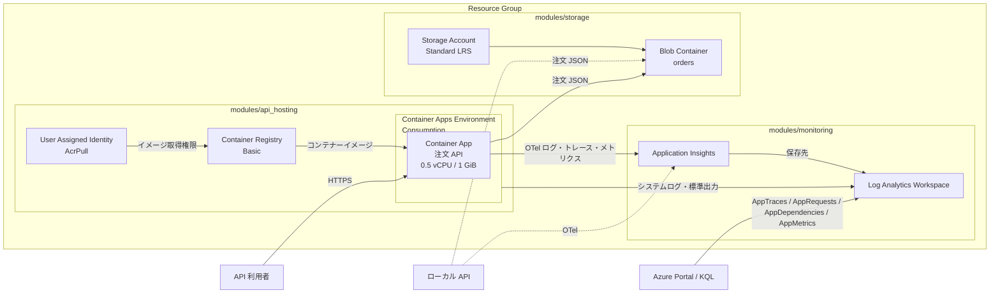
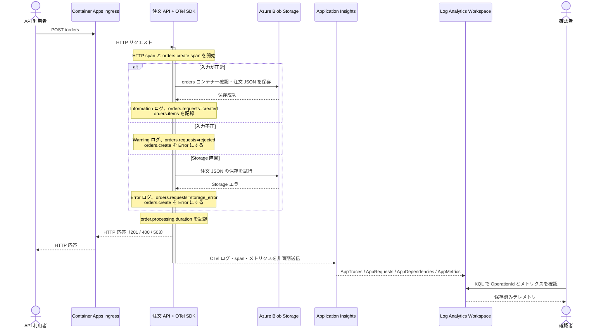

# Terraform と OpenTelemetry の Azure リソース設計

## 目的と対象範囲

この文書は、注文 API のログ・トレース・メトリクスを実際に Azure へ送り、Azure Portal と KQL で確かめるための実装方針です。Terraform コードとコンテナーイメージ用 Dockerfile は実装済みです。`terraform apply`、Azure リソース作成、イメージの push、実データの確認は未実施です。

最初の段階では API をローカルで実行し、Azure Blob Storage と Application Insights に接続します。API の Azure ホスティングは次段階に分けます。これなら既存の `Program.cs` の送信先切り替えを使い、監視基盤とアプリの計測を先に検証できます。

**API サーバーの Azure 配置先は Azure Container Apps、プランは Consumption ワークロードプロファイルとする。** 初期段階の `make api` はローカル検証用です。Azure 上で API を動かす段階では Container Apps Environment と Container App を Terraform の `modules/api_hosting` で作成します。[Container Apps のプラン構成](https://learn.microsoft.com/en-us/azure/container-apps/structure)を参照してください。

## データの流れ

```text
ローカル ASP.NET Core API
  ├─ 注文 JSON ────────────────→ Azure Blob Storage / orders コンテナー
  └─ OTel SDK + Azure Monitor Distro
       ├─ ILogger ログ ────────→ Application Insights ─→ Log Analytics / AppTraces
       ├─ HTTP・注文・Blob span → Application Insights ─→ AppRequests / AppDependencies
       └─ 注文メトリクス ───────→ Application Insights ─→ AppMetrics
```

ログ・トレース・メトリクスごとに Azure リソースを三つ作る構成ではありません。ワークスペースベースの Application Insights を共通の送信先とし、関連付けた Log Analytics Workspace の別テーブルで確認します。[Azure のデータモデル](https://learn.microsoft.com/en-us/azure/azure-monitor/app/data-model-request-telemetry)、[OTel 信号のテーブル対応](https://learn.microsoft.com/en-us/azure/azure-monitor/app/opentelemetry-filter)を参照してください。

## リソース構成図

次の図は `enable_api = true` にした Azure 配置後の構成です。破線は最初の段階で使うローカル API からの接続を示します。Container Apps の環境ログと、API が OTel で送るデータは別の経路です。



`Container App → Application Insights` は API 内の Azure Monitor Distro による直接送信です。`Container Apps Environment → Log Analytics Workspace` はプラットフォームのシステムログとコンソールログです。`AppTraces` などは Application Insights に関連付いた Workspace のテーブルです。

## 注文作成と OTel 出力のシーケンス図

この図は Azure 上の Container App へ `POST /orders` を送る場合です。トレース・ログ・メトリクスは API 内で記録され、Exporter がまとめて送信するため、Azure での表示は HTTP 応答より後になることがあります。



正常系の Blob SDK 呼び出しは、計測された場合 `AppDependencies` で追います。`orders.create` と HTTP リクエストは `OperationId` で関連付けます。メトリクスはリクエストごとのログ行ではなく集計値です。Container Apps のシステムログ・標準出力は上のリソース構成図の別経路で Workspace に入ります。

## Azure リソース（最初の段階）

| リソース | Terraform 管理の方針 | 用途 |
| --- | --- | --- |
| Resource Group | ルートで `azurerm_resource_group` | この演習用リソースのまとまり。名前は `rg-otel-order-api-<environment>` |
| Log Analytics Workspace | 必須の `modules/monitoring` | Application Insights の保存・KQL 検索先。`sku = "PerGB2018"`、`retention_in_days = 30` |
| Application Insights | 必須の `modules/monitoring` | `application_type = "web"`、`workspace_id` に上記 Workspace の ID を指定。API の Azure Monitor Distro の送信先 |
| Storage Account | 必須の `modules/storage` | 注文 JSON の保存先。`StorageV2`、Standard / LRS、HTTPS 必須、TLS 1.2、パブリック Blob アクセス禁止 |
| Blob Container | 必須の `modules/storage` | `orders`。匿名公開しない |

ワークスペースベースの Application Insights とその `connection_string` は [AzureRM Provider の `azurerm_application_insights`](https://registry.terraform.io/providers/hashicorp/azurerm/latest/docs/resources/application_insights) で管理します。OTel の送信には DCR、Azure Monitor Workspace、Collector を使わず、アプリから Application Insights へ直接送信します。Container Apps Environment は `modules/api_hosting` でホスト用に作成し、システムログと標準出力ログを同じ Log Analytics Workspace に送ります。Azure Monitor Workspace は、この構成の Log Analytics Workspace の代用品ではありません。

## Terraform の実装方針

Module 化は必須とします。ルートは Provider、リソースグループ、命名、タグ、Module 間の値の受け渡しだけを担当し、監視リソースとストレージリソースを各 Module に置きます。同じリポジトリの `resource-cleanup-checker/terraform` の構成を参考にできます。初回実装では `required_version = ">= 1.5.0, < 2.0.0"`、`hashicorp/azurerm` を `~> 5.4` とし、生成した `.terraform.lock.hcl` をコミットします。これによりチームで同じ Provider の版を使えます。

```text
otel-order-api/terraform/
├── versions.tf              # Terraform / azurerm のバージョン制約
├── providers.tf             # AzureRM Provider 設定
├── main.tf                  # Resource Group、共通タグ、Module 呼び出し
├── variables.tf             # subscription_id、location、environment、保持期間、日次上限、API の有効化
├── outputs.tf               # Workspace、Insights、Storage、API ホストの識別情報
├── terraform.tfvars.example # ダミー値のみ
└── modules/
    ├── monitoring/
    │   ├── main.tf          # Workspace、Application Insights
    │   ├── variables.tf
    │   └── outputs.tf       # Insights ID、Workspace ID、接続文字列
    ├── storage/
    │   ├── main.tf          # Storage Account、非公開 Blob Container
    │   ├── variables.tf
    │   └── outputs.tf       # Account 名、Container 名など
    └── api_hosting/
        ├── main.tf          # Container Apps Environment / App、ACR、Identity、AcrPull
        ├── variables.tf
        └── outputs.tf       # App FQDN、Registry login server
```

### ルートと Module の契約

| 箇所 | 入力・出力 | 値・規則 |
| --- | --- | --- |
| ルート入力 | `subscription_id` | 必須の文字列。AzureRM Provider の `subscription_id` に渡す。`terraform.tfvars.example` はプレースホルダーを記載 |
| ルート入力 | `environment` | 既定 `study`。小文字英数字のみ、3～12 文字の validation を付ける |
| ルート入力 | `name_suffix` | 既定は空文字。Storage 名が衝突した場合だけ英小文字数字で指定し、ハッシュの入力に追加する |
| ルート入力 | `location` | 既定 `japaneast`。全リソースに共通 |
| ルート入力 | `tags` | 既定 `{}`。`Project = "otel-order-api"`、`Environment`、`ManagedBy = "Terraform"` と merge |
| ルート入力 | `log_retention_days` | 既定 30。Workspace の `retention_in_days` に渡す。30～730 の validation を付ける |
| ルート入力 | `daily_data_cap_gb` | 既定 1。Insights の `daily_data_cap_in_gb` と Workspace の `daily_quota_gb` の両方に渡す。正数の validation を付ける |
| `monitoring` 入力 | `resource_group_name`, `location`, `environment`, `tags`, `log_retention_days`, `daily_data_cap_gb` | ルートから渡す。Module 内で `law-otel-order-api-<environment>` と `appi-otel-order-api-<environment>` を命名 |
| `monitoring` 出力 | `workspace_id`, `application_insights_id`, `application_insights_connection_string` | 最後の値は `sensitive = true` |
| `storage` 入力 | `resource_group_name`, `location`, `storage_account_name`, `container_name`, `tags` | `container_name` はルートから `orders` を渡す |
| `storage` 出力 | `storage_account_id`, `storage_account_name`, `container_name`, `blob_connection_string` | 最後の値は `sensitive = true`。`azurerm_storage_account.primary_connection_string` を返す |
| ルート出力 | `resource_group_name`, `workspace_id`, `application_insights_id`, `storage_account_name`, `container_name`, `application_insights_connection_string`, `blob_connection_string` | 接続文字列の二つは必ず `sensitive = true`。Module の出力を再公開する |

Storage Account 名はルートで `format("otelorder%s", substr(sha1(join("-", [var.subscription_id, var.environment, var.name_suffix])), 0, 8))` とする。英小文字と数字だけの 17 文字で、同じ入力なら再現可能です。グローバルな名前衝突が起きた場合だけ `name_suffix` を変えて再計画します。Module が別 Module のリソースを直接参照せず、ルートで入出力を結線します。

### 各リソースに設定する属性

| Terraform リソース | 必須設定 |
| --- | --- |
| `azurerm_log_analytics_workspace` | `name`, `location`, `resource_group_name`, `sku = "PerGB2018"`, `retention_in_days = var.log_retention_days`, `daily_quota_gb = var.daily_data_cap_gb`, `tags` |
| `azurerm_application_insights` | `name`, `location`, `resource_group_name`, `application_type = "web"`, `workspace_id = azurerm_log_analytics_workspace.this.id`, `daily_data_cap_in_gb = var.daily_data_cap_gb`, `daily_data_cap_notifications_enabled = true`, `tags` |
| `azurerm_storage_account` | `name`, `location`, `resource_group_name`, `account_kind = "StorageV2"`, `account_tier = "Standard"`, `account_replication_type = "LRS"`, `https_traffic_only_enabled = true`, `min_tls_version = "TLS1_2"`, `allow_nested_items_to_be_public = false`, `public_network_access = "Enabled"`, `shared_access_key_enabled = true`, `tags` |
| `azurerm_storage_container` | `name = var.container_name`, `storage_account_id = azurerm_storage_account.this.id`, `container_access_type = "private"` |

`public_network_access = "Enabled"` と `shared_access_key_enabled = true` は、ローカル API から接続文字列で試す現在のコードに必要です。演習用の Storage Account に限定し、Azure ホスティング時に認証とネットワークを見直します。[Workspace](https://registry.terraform.io/providers/hashicorp/azurerm/latest/docs/resources/log_analytics_workspace)、[Insights](https://registry.terraform.io/providers/hashicorp/azurerm/latest/docs/resources/application_insights)、[Storage Account](https://registry.terraform.io/providers/hashicorp/azurerm/latest/docs/resources/storage_account)、[Container](https://registry.terraform.io/providers/hashicorp/azurerm/latest/docs/resources/storage_container) の Provider 資料に対応します。

### state と課金

`.terraform.lock.hcl` はコミットし、`terraform.tfstate*`、`.terraform/`、`*.tfvars`、`*.tfplan` は `terraform/.gitignore` で除外します。初回の個人演習はローカル state とし、共有運用へ移る前にアクセス制御・暗号化・ロックのある remote backend を別途用意します。`sensitive` は CLI の通常表示を隠すだけで、接続文字列と Storage キーは state に残ります。state や `terraform output -json` を公開しません。

Workspace と Insights の日次上限を両方設定します。ワークスペースベースの Insights では低い方の上限が有効です。上限到達後はテレメトリが欠落するため、最初の検証では取り込み量も確認します。[Microsoft の日次上限の説明](https://learn.microsoft.com/en-us/azure/azure-monitor/logs/daily-cap)を参照してください。演習終了時の `terraform destroy` は対象プランを確認して実行します。

### 認証と設定値

初期段階は現在の `BlobContainerClient` 実装に合わせ、Storage の接続文字列を `Blob__ConnectionString`、コンテナー名を `Blob__ContainerName`、Insights の接続文字列を `APPLICATIONINSIGHTS_CONNECTION_STRING` としてローカル API に渡します。環境変数へ渡す具体的な手順は Terraform 実装時の README に記載します。実値を README、tfvars、コマンド履歴、Git 管理下のファイルへ貼り付けません。Storage のアカウントキーを扱う方式なので、後で API を Azure に配置する際は Managed Identity と Blob Data 権限を使うようアプリ設定と認証コードを改修します。

Insights の接続文字列を設定した実行では、現行 `Program.cs` は `UseAzureMonitor()` を有効にします。未設定で `OTEL_EXPORTER_OTLP_ENDPOINT` が指定されていれば OTLP Exporter、それも未設定なら Console Exporter が有効になります。`OTEL_SERVICE_NAME=otel-order-api` を設定し、Azure の画面でサービスを識別しやすくします。[Azure Monitor Distro の設定](https://learn.microsoft.com/en-us/azure/azure-monitor/app/opentelemetry-configuration)を参照してください。

### 実装後の操作手順として README に追記する内容

作成時の手順は、プロジェクト直下から次の順に実行できる形で README に記載します。`terraform apply` は Azure の実リソースと料金に影響するため、`plan` の作成対象と subscription を確認してから実行します。

```sh
az login
az account set --subscription '<対象の subscription ID>'
az account show --query id -o tsv
terraform -chdir=terraform init
terraform -chdir=terraform fmt -check -recursive
terraform -chdir=terraform validate
terraform -chdir=terraform plan -var='subscription_id=<対象の subscription ID>'
terraform -chdir=terraform apply -var='subscription_id=<対象の subscription ID>'
```

作成後、同じシェルで次の値を環境変数へ渡し、`make api` で起動します。`make dev` は Azurite も起動するため、この段階の手順では `make api` を使います。`terraform output -raw` は秘密値を標準出力へ直接表示できるコマンドなので、出力先を追加してログへ残さないでください。

```sh
export APPLICATIONINSIGHTS_CONNECTION_STRING="$(terraform -chdir=terraform output -raw application_insights_connection_string)"
export Blob__ConnectionString="$(terraform -chdir=terraform output -raw blob_connection_string)"
export Blob__ContainerName="$(terraform -chdir=terraform output -raw container_name)"
export OTEL_SERVICE_NAME=otel-order-api
make api
```

実装成果物は、上記の Terraform ファイル、`.gitignore`、ダミー値だけの `terraform.tfvars.example`、README の手順です。`Program.cs` の OTel 切り替えや注文処理コードはこの段階の対象外です。`terraform fmt -check -recursive` と `terraform validate` が通り、`plan` に Resource Group、Workspace、Insights、Storage Account、Blob Container の五つが現れる状態を完了条件にします。Azure 作成と実データの確認は、その後の実行段階の完了条件です。

## 三つのシグナルと確認する内容

| シグナル | 現行コードの発生源 | Azure での確認先 | 合格条件 |
| --- | --- | --- | --- |
| ログ | `ILogger` の作成成功、入力拒否、ストレージ障害など | `AppTraces`。例外は `AppExceptions` に出る場合もある | 各操作のログ、重大度、同じ `OperationId` を確認できる |
| トレース | HTTP リクエスト、`orders.create` / `orders.get`、Azure Blob SDK | `AppRequests` と `AppDependencies`、Application Insights のトランザクション検索 | リクエストと独自スパンを同じ `OperationId` で追える。Blob 依存関係は SDK 計測の実際の出力を確認する |
| メトリクス | `orders.requests`、`order.processing.duration`、`orders.items` | `AppMetrics` と Application Insights の Metrics | 成功と拒否のカウント、処理時間、成功時の商品数が増える |

`orders.create` などの内部 span の表示種別や Blob SDK の依存関係名は SDK の変換と版で変わり得るため、固定の行名を合格条件にしません。メトリクスは集計値であり、1 リクエストごとに即時 1 行を期待しません。ログ、トレース、メトリクスの取り込みには数分かかる場合があります。[OTel の有効化と確認](https://learn.microsoft.com/en-us/azure/azure-monitor/app/opentelemetry-enable?tabs=aspnetcore)を参照してください。

### 検証の順番

1. Terraform `plan` を確認し、Workspace、Insights、Storage Account、Blob Container に加え、Container Apps Environment、ACR、Managed Identity、`AcrPull` ロールを作る。`enable_api` は既定 `false` のため、Container App はこの段階では作らない。
2. Azure の接続文字列とコンテナー名をローカル API に渡し、`POST /orders` の成功と `GET /orders/{id}` を実行する。注文 JSON が Azure Blob に存在することも確認する。
3. `quantity: 0` で `POST /orders` を呼び、400、Warning ログ、`result=rejected` のメトリクスを確認する。
4. ストレージ障害を試す場合は一時的に `Blob__ConnectionString=UseDevelopmentStorage=true` で API を `make api` から起動し、Azurite は停止した状態で注文を作成する。503、Error ログ、`result=storage_error` を確認後、Azure の接続文字列へ戻す。共有ストレージを停止・削除して障害を作らない。
5. Application Insights の Logs または Workspace の Logs で次の KQL を実行し、トレース ID で突き合わせる。

```kusto
AppRequests
| where TimeGenerated > ago(30m)
| project TimeGenerated, Name, ResultCode, Success, OperationId
| order by TimeGenerated desc
```

```kusto
let operation = "<AppRequests の OperationId>";
union withsource=SourceTable AppRequests, AppDependencies, AppTraces
| where TimeGenerated > ago(30m) and OperationId == operation
| project TimeGenerated, SourceTable, Name, Message, OperationId
| order by TimeGenerated asc
```

```kusto
AppMetrics
| where TimeGenerated > ago(30m)
| where Name in ("orders.requests", "order.processing.duration", "orders.items")
| project TimeGenerated, Name, Sum, ItemCount, Properties
| order by TimeGenerated desc
```

Log Analytics の `App*` テーブル名を前提としたクエリです。Application Insights リソース内の Logs で旧来のテーブル名が表示される場合は、Workspace 側の Logs から実行します。少量の検証で span やログが欠ける場合は、まず接続文字列、プロセス再起動、取り込み遅延を確認し、次にサンプリング設定を確認します。Azure Monitor Distro はトレースをサンプリングし得ますが、メトリクスはサンプリングされません。[サンプリングの公式説明](https://learn.microsoft.com/en-us/azure/azure-monitor/app/sampling)を参照してください。

## API サーバーを Azure に配置する段階

ローカルからの OTel 出力を確認した後、次のリソースを追加します。ホスト用 Module を必ず使い、ルートにはホストのリソース定義を直接置きません。

| リソース | プラン・設定 | 役割 |
| --- | --- | --- |
| Azure Container Apps Environment | Consumption ワークロードプロファイル。`logs_destination = "log-analytics"` と既存 Workspace の ID | Container App の実行環境、システムログと標準出力ログの送信先 |
| Azure Container App | Consumption、コンテナー 1 個、`cpu = 0.5`、`memory = "1Gi"`、`min_replicas = 0`、`max_replicas = 1` | ASP.NET Core API 本体。HTTP リクエストで起動し、アイドル時は 0 まで縮退 |
| Azure Container Registry | Basic、管理者ユーザー無効 | API のプライベートイメージの保存先 |
| User Assigned Managed Identity とロール割り当て | Registry に `AcrPull` | Container App がイメージを取得するための認証 |

`0.5 vCPU / 1 GiB` は Consumption の有効な組み合わせです。演習用途なので最大 1 レプリカとし、常時稼働を求める場合は `min_replicas` を 1 に上げます。0 の場合、最初の HTTP リクエストにコールドスタートの遅延が生じ得ます。[CPU とメモリの組み合わせ](https://learn.microsoft.com/en-us/azure/container-apps/containers)、[スケール設定](https://learn.microsoft.com/en-us/azure/container-apps/scale-app)を参照してください。

`modules/api_hosting` に Environment、App、Registry、Identity、`AcrPull` ロールを置きます。ルートから `resource_group_name`、`location`、`environment`、`tags`、Workspace ID、Insights 接続文字列、Blob 接続文字列、コンテナー名、イメージタグ、`enable_api` を渡し、App の FQDN と Registry の login server を出力します。Registry 名は Storage と同様、subscription / environment から作る英数字のハッシュでグローバル一意にします。Registry は `sku = "Basic"`、`admin_enabled = false`。Identity を先に作成し、Registry スコープに `AcrPull` を付けてから App の private image pull に使います。App リソースにはロール割り当てへの明示的な依存を設定します。[Managed Identity によるイメージ取得](https://learn.microsoft.com/en-us/azure/container-apps/managed-identity-image-pull)、[ACR の Terraform 設定](https://registry.terraform.io/providers/hashicorp/azurerm/latest/docs/resources/container_registry)を参照してください。

App は外部 HTTP ingress を有効にし、コンテナーの `ASPNETCORE_URLS=http://0.0.0.0:8080` と ingress の target port 8080 を一致させます。`/health` を readiness と liveness の確認先とします。`APPLICATIONINSIGHTS_CONNECTION_STRING` と `Blob__ConnectionString` は Container App の secret に設定し、環境変数から secret を参照します。`Blob__ContainerName=orders` と `OTEL_SERVICE_NAME=otel-order-api` も設定します。既存コードは Storage 接続文字列で認証するため、この段階ではその方式を使用します。後で Blob への Managed Identity 認証に移す際は `BlobContainerClient` の生成方法と Storage Blob Data 権限を変更します。Terraform state には引き続き接続文字列が残ります。

イメージが Registry に存在しない状態では App の初回リビジョンを起動できません。ホスト用 Module は常に呼び、Module 内の App リソースだけを `enable_api` で条件付き作成します。既定は `false` とし、最初の `apply` で Environment・Registry・Identity・ロールを作成します。Dockerfile からイメージをビルドして ACR に push した後、タグを指定して `enable_api = true` で再度 `apply` する二段階手順を README に記載します。App の FQDN 出力は無効時に `null` を返します。

Container Apps のシステムログ・標準出力ログは、アプリが Distro で送る `AppTraces` とは別経路で Workspace に届きます。確認時は `ContainerAppSystemLogs_CL` / `ContainerAppConsoleLogs_CL` と `AppTraces` を区別し、同じアプリログが二重に取り込まれる場合は出力設定を見直します。[Container Apps のログ種別](https://learn.microsoft.com/en-us/azure/container-apps/log-monitoring)を参照してください。
